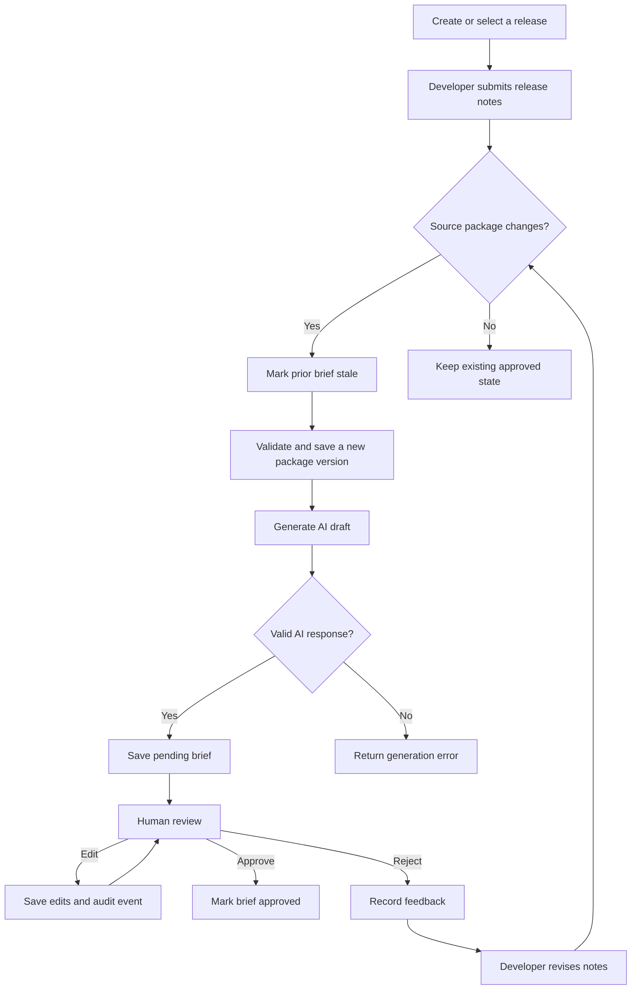

# Release Assistant

Release Assistant turns structured release notes into reviewable release briefs. It keeps release packages and brief versions in MongoDB, uses Gemini to draft summaries and QA/evidence information, and provides a human review workflow before a brief is approved.

The application is split into a React/Vite frontend and an Express/Mongoose API. The API can be deployed to Render and the frontend to Vercel.

## What it does

- Organizes work under releases, each with a name, optional feature tag, and creator.
- Stores release notes as immutable, numbered package versions.
- Generates a technical and a client-facing draft from a package using Gemini.
- Adds warnings, evidence citations, and QA evidence checks to help reviewers evaluate the draft.
- Keeps the AI-generated content separately from the current editable brief content.
- Supports editing, approval, and rejection with reviewer history.
- Marks briefs stale when a newer package is saved, and prevents stale briefs from being edited or approved.
- Compares two brief versions and their source packages, with deterministic field and citation diffs plus optional AI analysis.
- Uses Upstash Redis as an expiring cache for completed comparison results to reduce repeat comparison work and Gemini calls.
- Streams brief generation and comparison progress to the website with Server-Sent Events (SSE), including partial AI summary previews.

## Application workflow



### Workflow details

1. **Create a release.** A release is the parent record that tracks the current package and brief versions.
2. **Submit a package.** Developers enter completed features, bug fixes, changed behavior, QA summary, limitations, migration notes, and affected user groups. The backend validates the request and saves it as the next package version.
3. **Invalidate previous review state.** When the source notes change, saving a newer package marks prior briefs for that release stale and invalidates cached comparisons. A stale brief remains in history, but cannot be edited, rejected, or approved. If there are no source changes, keep the existing approved state rather than creating a new version.
4. **Generate a draft.** A brief can be generated from the latest package version. The backend sends the package information to Gemini and validates the structured result, including supported output fields and evidence references. A generated brief starts with `pending` status. If a brief already exists for that package version, the existing brief is returned rather than generating a duplicate.
5. **Review the draft.** A reviewer can edit the brief, approve it, or reject it with feedback. Changes and review actions are recorded in the brief's review history. The original AI output remains available separately from the edited content.
6. **Compare versions.** A reviewer selects two different brief versions. The API compares brief fields, citations, and source packages. Citation matching includes exact and heuristic matches; heuristic matches are marked as such and should be reviewed.
7. **Reuse comparison results.** Completed comparison results may be served from Redis. A release revision is part of the cache key; package and review changes increment that revision so old cached results are no longer selected. Cache entries also expire based on the configured TTL.

## Architecture

```text
frontend/                       backend/
React 19 + Vite                 Node.js + Express
  App and workflow UI             Routes -> Controllers -> Services
  API client                      Services -> Repositories -> Mongoose
  VITE_API_BASE_URL                         |          |
       |                                    |          +--> MongoDB (source of truth)
       +---------- HTTP / JSON ------------+           +--> Gemini API (drafts/analysis)
                                                    +--> Upstash Redis (comparison cache)
```

### Backend components

- **Routes** define the `/api/v1/releases` HTTP API.
- **Controllers** translate HTTP input into service calls and format JSON responses.
- **Services** implement release, package, brief, AI, and comparison workflows.
- **Repositories** isolate MongoDB queries.
- **Mongoose models** define release, package, brief, citation, warning, QA evidence, and review-history records.
- **Application errors and logger** provide consistent error handling and structured logs. Requests receive an `X-Request-ID`; log output is JSON and sensitive-looking fields are redacted.

### Frontend components

- **App** loads releases and switches between release management, package creation, and the brief workspace.
- **CreateReleaseForm / CreatePackageForm** collect release and source-note information.
- **BriefWorkspace** loads package and brief history and coordinates generation, editing, review, and comparison.
- **BriefDetailsPanel / BriefHistoryList / BriefComparisonPanel** present the brief, versions, review state, and comparison output.
- **API client** sends requests to the configured `VITE_API_BASE_URL`.

## Data model

| Record | Purpose | Important fields |
|---|---|---|
| Release | Parent record and current-version pointers | `release_name`, `feature_tag`, `created_by`, `current_package_version`, `current_brief_version` |
| Release package | Versioned source notes submitted by developers | `release_id`, `package_version`, `completed_features`, `bug_fixes`, `changed_behaviour`, `qa_summary`, `known_limitations`, `migration_notes`, `affected_user_groups` |
| Release brief | AI-generated and human-reviewed output | `release_id`, `package_version`, `brief_version`, `ai_generated`, editable summaries, warnings, citations, QA evidence, `status`, `is_stale`, `review_history` |


Brief status values include `processing`, `pending`, `approved`, `rejected`, and `failed`. A brief version is unique within its release, and a package version is unique within its release.

MongoDB is the persistent source of truth for releases, packages, briefs, and review history. Redis stores only comparison cache entries; it is not the database for the release records.

## API overview

All application endpoints are under `/api/v1`. Successful responses generally use `{ "success": true, "data": ... }`; errors use `{ "success": false, "message": ... }`.

| Method | Path | Purpose |
|---|---|---|
| `GET` | `/api/health` | Health check (outside the `/api/v1` prefix) |
| `POST` | `/api/v1/releases` | Create a release |
| `GET` | `/api/v1/releases` | List releases |
| `GET` | `/api/v1/releases/:releaseId` | Get one release |
| `POST` | `/api/v1/releases/:releaseId/packages` | Create the next package version |
| `GET` | `/api/v1/releases/:releaseId/packages` | List package history |
| `GET` | `/api/v1/releases/:releaseId/packages/:packageVersion` | Get one package version |
| `POST` | `/api/v1/releases/:releaseId/briefs/from-package/:packageVersion` | Generate or retrieve the brief for a package version |
| `GET` | `/api/v1/releases/:releaseId/briefs` | List brief history |
| `GET` | `/api/v1/releases/:releaseId/briefs/:briefId` | Get one brief |
| `PATCH` | `/api/v1/releases/:releaseId/briefs/:briefId` | Edit a brief |
| `POST` | `/api/v1/releases/:releaseId/briefs/:briefId/approve` | Approve a pending brief |
| `POST` | `/api/v1/releases/:releaseId/briefs/:briefId/reject` | Reject a pending brief with feedback |
| `GET` | `/api/v1/releases/:releaseId/briefs/compare?from=1&to=2` | Compare two brief versions |

The brief generation and comparison endpoints keep their normal JSON responses for tools such as Postman. Add `stream=true` to either request to receive an SSE stream instead. The website uses this mode to show progress and partial Gemini summaries while the backend continues validating the complete structured response before saving or displaying the final result.

Reviewer identity is currently supplied to the API as `reviewer_id`; this project does not currently implement user authentication or authorization. Do not treat a reviewer ID as proof of identity. Add an authentication/authorization layer before using the application for workflows that require verified identities or access control.

## Technology and design decisions

### React and Vite for the frontend

The interface is a client-rendered React application built with Vite. It is deployed as a static site; the API origin is injected at build time with `VITE_API_BASE_URL`. Keeping the API base configurable allows local, preview, and production builds to use different API deployments without hard-coding a server address in application code.

### Express and service/repository layers for the backend

The backend uses Express for a small JSON API. Route, controller, service, repository, and model responsibilities are separated so HTTP handling and database operations do not need to be mixed into the AI workflow.

### MongoDB for versioned business data

MongoDB stores records that must survive restarts and deployments. Package and brief version indexes prevent duplicate version records within a release. Current version pointers on a release make the latest package and brief discoverable without replacing their histories.

### Gemini for drafting, not final authority

Gemini is used to create draft summaries and assist with comparison analysis. The generated brief includes evidence-oriented fields such as citations and QA checks, but these do not prove that a claim is factually correct. Human review remains part of the lifecycle; the AI output is not automatically approved.

### Redis as an optional comparison cache

Comparison results are expensive to recompute when AI analysis is involved, so Upstash Redis is used as a cache rather than as the authoritative store. Keys are scoped by release, cache revision, and requested brief versions. Review/package changes invalidate the release's current cache revision. If Redis is not configured or a cache operation fails, the API logs the cache issue and computes the comparison without a cache result.

### Render and Vercel deployment split

Render runs the Node API and connects it to hosted MongoDB, Gemini, and optionally Upstash. Vercel builds and serves the static frontend. Exact-origin CORS configuration allows the Vercel site to call the API while keeping local development origins available as defaults in development.

### LangGraph is not part of this application

The current AI tasks are request/response operations with defined service steps and validation. LangGraph would add workflow orchestration capabilities, but is not required simply to make these operations faster. The existing architecture keeps that choice open if the workflow later needs persistent multi-step AI state, branching agent tasks, or resumable orchestration.

## Requirements

- Node.js `>=22.12.0 <23` (both package manifests declare this range).
- npm (lockfiles are checked in; use `npm ci`).
- MongoDB for persisted application data.
- A Gemini API key for brief generation and AI comparison analysis.
- Upstash Redis REST URL and token for comparison caching (optional; comparisons can run without it).

## Local development

### Set up the project from GitHub

Clone the repository and enter the project directory:

```powershell
git clone https://github.com/kushkrrish/release-assistant.git
Set-Location release-assistant
```

Make sure the required tools and services listed in [Requirements](#requirements) are available, then follow the backend and frontend setup steps below.

### 1. Configure the backend

```powershell
Copy-Item backend/.env.example backend/.env
```

Edit `backend/.env` and provide valid values for `MONGO_URI` and `GEMINI_API_KEY`. To enable comparison caching, also configure `UPSTASH_REDIS_REST_URL` and `UPSTASH_REDIS_REST_TOKEN`. Never commit `.env` files or expose credentials in frontend `VITE_*` variables.

### Add demo data for reviewers

To make a sample release and package available in the app, configure `MONGO_URI` and `DEMO_MONGO_URI` to the **same dedicated database** whose name includes `demo` or `test`. For example, for a local MongoDB instance:

```dotenv
MONGO_URI=mongodb://localhost:27017/release-assistant-demo
DEMO_MONGO_URI=mongodb://localhost:27017/release-assistant-demo
```

For a hosted database, use a separate demo/test database in your MongoDB connection URI. Do not point this command at a production database. From the `backend/` directory, install dependencies and seed the sample data:

```powershell
npm ci
npm run seed:demo
```

The script creates a clearly labeled **Demo Release - Checkout Improvements** and package version 1 with sample feature, bug-fix, QA, limitation, migration, and affected-user notes. It is safe to rerun: an existing seed package is left unchanged. The script refuses to run unless `DEMO_MONGO_URI` is set and the URI's database name contains `demo` or `test`.

Start the app with `MONGO_URI` pointing to that same database. In the UI, select **Demo Release - Checkout Improvements**, open the brief workspace, and generate a brief from package version 1. Gemini credentials are still needed for brief generation; Redis remains optional.

To explicitly seed the database configured as the running backend's `MONGO_URI` instead, run this command from the deployed Render service shell after deploying the seeder:

```sh
npm run seed:demo -- --use-app-database
```

This opt-in inserts the sample release/package into the app's configured database. It does not overwrite existing records and can be rerun safely, but the added demo data will be visible to everyone using that database. Do not run it against production unless you intend to add shared demo records there.

### 2. Install and run the backend

```powershell
Set-Location backend
npm ci
npm run dev
```

The API defaults to `http://localhost:5000`; the health endpoint is `http://localhost:5000/api/health`.

### 3. Configure and run the frontend

In another terminal:

```powershell
Copy-Item frontend/.env.example frontend/.env
Set-Location frontend
npm ci
npm run dev
```

The frontend defaults to `http://localhost:5173` and the local API base URL `http://localhost:5000/api/v1`. If the backend runs elsewhere, set `VITE_API_BASE_URL` in `frontend/.env` and restart Vite.

## Environment variables

### Backend

| Variable | Required? | Purpose |
|---|---|---|
| `PORT` | Render supplies it; optional locally | HTTP listen port (local default `5000`) |
| `NODE_ENV` | Recommended | Runtime mode; use `production` on Render |
| `MONGO_URI` | Yes for persistence | MongoDB connection string. The code has a local development fallback; production must use a hosted database URI. |
| `DEMO_MONGO_URI` | Only for seeding demo data | Explicit MongoDB connection URI for `npm run seed:demo`; the database name must include `demo` or `test`. |
| `GEMINI_API_KEY` | Yes for AI generation/analysis | Gemini API credential |
| `GEMINI_MODEL` | No | Gemini model ID; defaults to `gemini-3.5-flash-lite`. Confirm the configured model is available to the API key. |
| `CORS_ORIGINS` | Recommended in production | Comma-separated, exact frontend origins, with no trailing slash |
| `LOG_LEVEL` | No | Minimum structured-log severity (default `info`) |
| `UPSTASH_REDIS_REST_URL` | Optional | Upstash Redis REST endpoint |
| `UPSTASH_REDIS_REST_TOKEN` | Optional | Upstash Redis REST token |
| `COMPARISON_CACHE_TTL_SECONDS` | No | Comparison cache lifetime in seconds (default `86400`) |

`CORS_ORIGINS` defaults to `http://localhost:5173,http://127.0.0.1:5173`. Set it in Render to the deployed Vercel origin, for example `https://your-app.vercel.app`. To allow more than one frontend origin, separate them with commas.

### Frontend

| Variable | Purpose |
|---|---|
| `VITE_API_BASE_URL` | API base including the version prefix, e.g. `https://your-api.onrender.com/api/v1` |

Vite embeds `VITE_*` values in the browser bundle. They are public configuration, not secrets.

## Deployment

### Render backend

The root [`render.yaml`](./render.yaml) defines the backend web service:

- Root directory: `backend`
- Build command: `npm ci`
- Start command: `npm start`
- Health check: `/api/health`

Create or update the Render Blueprint, then provide `MONGO_URI`, `GEMINI_API_KEY`, and `CORS_ORIGINS` in the Render environment settings. Configure the Upstash values if comparison caching is desired. Render supplies `PORT` automatically. Use a hosted MongoDB URI, not the local fallback.

### Vercel frontend

Import the repository into Vercel with the project root directory set to `frontend`. The [`frontend/vercel.json`](./frontend/vercel.json) configures the Vite build, `dist` output, and SPA fallback. Set `VITE_API_BASE_URL` in Vercel to the Render API URL ending in `/api/v1` and redeploy after changing it.

After deploying the frontend, copy its exact origin into Render's `CORS_ORIGINS` and redeploy/restart the backend. If the backend deploys first, it can be deployed before the Vercel URL is known; update CORS once the frontend is deployed.

For more deployment notes, see [`DEPLOYMENT.md`](./DEPLOYMENT.md).

## Validation commands

```powershell
# Frontend static checks and production bundle
Set-Location frontend
npm run lint
npm run build

# Backend syntax check (run from repository root)
Get-ChildItem backend/src -Recurse -Filter *.js | ForEach-Object { node --check $_.FullName }
```

The backend package currently has no automated test suite configured; its `npm test` script is a placeholder that exits with an error.

## Project layout

```text
.
|-- backend/
|   |-- src/
|   |   |-- config/          # Environment configuration and MongoDB connection
|   |   |-- controllers/     # HTTP request/response handlers
|   |   |-- models/          # Mongoose schemas
|   |   |-- repository/      # Database access
|   |   |-- routes/          # API route definitions
|   |   |-- services/        # Release, brief, Gemini, comparison, and cache logic
|   |   `-- utils/           # Application errors and structured logging
|   |-- .env.example
|   `-- package.json
|-- frontend/
|   |-- src/
|   |   |-- api/             # HTTP client and API functions
|   |   |-- components/      # Forms and review/comparison UI
|   |   `-- utils/           # Brief formatting and validation helpers
|   |-- .env.example
|   |-- vercel.json
|   `-- package.json
|-- render.yaml
|-- README.md
`-- DEPLOYMENT.md
```

## Security and operational notes

- Keep MongoDB, Gemini, and Redis credentials only in backend environment configuration. Rotate credentials that have been exposed and update the hosted service with the replacement values.
- Do not put backend secrets in Vercel or in any variable prefixed with `VITE_`.
- Configure MongoDB network access and database users according to the database provider's production guidance.
- CORS is not authentication. The current API does not authenticate users or enforce per-user authorization.
- AI-generated content, citations, and heuristic citation matches require human judgment.
- MongoDB holds durable records. Redis is a cache and may be flushed without deleting releases, packages, or briefs.
- The deployment guide describes platform configuration; a successful build alone does not confirm database credentials, network access, CORS, or AI-provider configuration.
